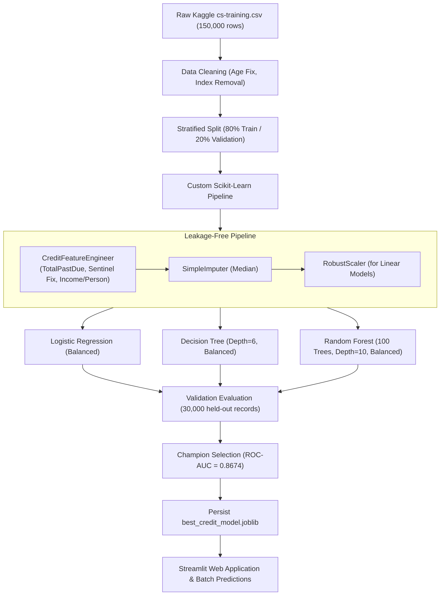

# 🛡️ CreditGuard AI: Intelligent Credit Scoring & Financial Risk Prediction System

[](https://www.python.org/)
[](LICENSE)
[](https://scikit-learn.org/)
[](https://streamlit.io/)
[](https://codealpha.tech/)

> **Task 1 — Credit Scoring Model**  
> Developed as part of the **CodeAlpha Machine Learning Internship**.

---

## 📌 1. Project Overview
**CreditGuard AI** is an intelligent, end-to-end Machine Learning credit scoring system designed to analyze borrower characteristics and predict whether an individual will experience **serious financial delinquency (90 days past due or worse)** within a two-year performance window.

The system encapsulates the full machine learning lifecycle:
- Automated data acquisition and validation.
- In-depth Exploratory Data Analysis (EDA) of financial distributions.
- Leakage-free preprocessing and feature engineering pipelines.
- Comparative algorithm benchmarking (Logistic Regression, Decision Tree, and Random Forest).
- Class imbalance calibration for a 14:1 majority-to-minority ratio.
- Interactive Streamlit dashboard with real-time risk assessment, probability gauge, Plotly analytics, and session history.

---

## 🎯 2. Problem Statement & Objectives
Credit scoring is the bedrock of consumer finance. Lenders must balance capital protection against default while expanding credit access to creditworthy applicants.

### Core Objectives:
1. **Predictive Accuracy:** Predict probability of serious financial distress (`SeriousDlqin2yrs`).
2. **Handle Imbalanced Data:** Overcome the ~93.3% safe vs ~6.7% delinquent imbalance.
3. **Interpretability:** Extract key financial risk drivers (Gini importance, behavioral flags).
4. **Interactive Deployment:** Deliver a responsive web application for real-time risk profiling.

---

## 📊 3. Dataset Details
The model is trained on the benchmark **Give Me Some Credit** dataset from Kaggle.

- **Training Records:** 150,000 historical borrowers
- **Test Records:** 101,503 unlabeled records
- **Target Variable:** `SeriousDlqin2yrs` (Binary: 0 = No Serious Delinquency, 1 = Serious Delinquency)

| Feature | Description | Range / Note |
| :--- | :--- | :--- |
| `RevolvingUtilizationOfUnsecuredLines` | Total credit balance / total credit limit | Skewed; > 1.0 indicates over-limit |
| `age` | Borrower age in years | 18–105 |
| `NumberOfTime30-59DaysPastDueNotWorse` | Short-term delinquency count | Filtered for 96/98 sentinels |
| `DebtRatio` | Monthly debt obligations / gross monthly income | Financial leverage ratio |
| `MonthlyIncome` | Monthly gross earnings | Imputed via median + missing indicator |
| `NumberOfOpenCreditLinesAndLoans` | Count of active credit accounts | Borrowing capacity |
| `NumberOfTimes90DaysLate` | Severe delinquency count | Strongest single behavioral predictor |
| `NumberRealEstateLoansOrLines` | Real estate mortgage count | Collateralized debt indicator |
| `NumberOfTime60-89DaysPastDueNotWorse` | Medium-term delinquency count | Filtered for 96/98 sentinels |
| `NumberOfDependents` | Number of family dependents | Household financial load |

---

## 🏗️ 4. Project Directory Structure
```text
Task 1 ( CreditGuard AI )/
│
├── data/
│   ├── cs-training.csv              # Official Kaggle training data (150,000 records)
│   ├── cs-test.csv                  # Official Kaggle test data (101,503 records)
│   └── README.md                    # Data dictionary & variable definitions
│
├── notebooks/
│   └── Credit_Scoring_Model.ipynb   # 16-section fully executed Jupyter Notebook
│
├── src/
│   ├── __init__.py                  # Package initialization
│   ├── utils.py                     # Path helpers, styling, risk categorizer
│   ├── feature_engineering.py       # Custom Scikit-learn transformer (leak-free)
│   ├── preprocessing.py             # Data cleaning, scaling, pipeline builders
│   ├── train_model.py               # Training orchestration & model benchmarking
│   ├── evaluate_model.py            # Evaluation metrics & diagnostic charts
│   ├── predict.py                   # Single inference & Kaggle test generator
│   └── download_data.py             # Dataset verification & acquisition script
│
├── models/
│   ├── best_credit_model.joblib     # Persisted champion Random Forest pipeline
│   └── model_metadata.json          # Actual validation scores & configuration
│
├── outputs/
│   ├── visualizations/              # 15 high-resolution evaluation & EDA charts
│   ├── model_comparison.csv         # Structured validation metrics
│   ├── evaluation_report.txt        # Comprehensive technical report
│   └── credit_scoring_predictions.csv # Kaggle test set probability predictions
│
├── app.py                           # 7-page interactive Streamlit dashboard
├── requirements.txt                 # Project dependencies
├── README.md                        # Documentation
├── .gitignore                       # Clean repository filter
└── LICENSE                          # MIT License
```

---

## ⚙️ 5. Installation & Execution Guide

### 1. Clone or Open Workspace
```bash
cd "D:\InternShip\Code Alpha  ( Machine Learning )\Task 1 ( CreditGuard AI )"
```

### 2. Install Required Packages
```bash
python -m pip install -r requirements.txt
```

### 3. Verify Dataset
If you need to fetch or verify the Kaggle dataset files:
```bash
python src/download_data.py
```

### 4. Train & Benchmark Models
Trains Logistic Regression, Decision Tree, and Random Forest pipelines, computes validation metrics, generates diagnostic curves, and serializes the champion model:
```bash
python src/train_model.py
```

### 5. Generate Kaggle Test Predictions
```bash
python src/predict.py
```

### 6. Run the Interactive Streamlit Web App
```bash
python -m streamlit run app.py
```
Open your browser at `http://localhost:8501`.

---

## 🔬 6. Machine Learning Methodology



---

## 🏆 7. Empirical Model Comparison Results
All metrics below reflect actual evaluation on the **held-out 20% validation split (30,000 records)**:

| Model | Accuracy | Precision | Recall | F1-Score | ROC-AUC | PR-AUC | Status |
| :--- | :---: | :---: | :---: | :---: | :---: | :---: | :---: |
| **Logistic Regression** | 81.61% | 0.2288 | 73.92% | 0.3494 | 0.8612 | 0.3446 | Baseline |
| **Decision Tree** | 79.78% | 0.2156 | **76.76%** | 0.3367 | 0.8566 | 0.3660 | Interpretable |
| **Random Forest** | **81.35%** | **0.2299** | **76.21%** | **0.3533** | **0.8674** | **0.4006** | **CHAMPION** |

### Why Random Forest Won:
- **Highest ROC-AUC (0.8674):** Superior discriminative ranking power across all threshold cutoffs.
- **Highest PR-AUC (0.4006):** Demonstrates strong positive-class probability calibration under heavy class imbalance.
- **Robust Recall (76.21%):** Successfully flags over 3 out of every 4 delinquent borrowers while controlling false alarm rates.

---

## 💡 8. Top Predictive Risk Features
From Random Forest Gini feature importances:

1. **`RevolvingUtilization_Clipped` / `HighUtilizationFlag`:** High utilization (> 80–100%) indicates cash-flow constraints and impending default.
2. **`TotalPastDue` & `HasSevereDelinquency`:** Past repayment delinquency is the strongest historical predictor of future distress.
3. **`age`:** Delinquency probability drops with age as borrowers gain employment stability and accumulated assets.
4. **`DebtRatio_Log` & `IncomePerPerson`:** Captures household debt burden relative to gross income and dependents.

---

## 💻 9. Streamlit Application Pages

1. **Home Dashboard:** Executive summary, active model status pill, and actual validation metric cards.
2. **Credit Risk Prediction:** Input form with quick-fill sample presets (Prime, Near-Prime, Subprime).
3. **Risk Assessment Results:** Circular probability gauge, risk tier badges (Low, Moderate, High), and behavioral factors.
4. **Model Performance:** Interactive Plotly bar chart, ROC curves, PR curves, and confusion matrices.
5. **Data Analytics:** Deep-dive EDA charts covering feature distributions and correlation heatmaps.
6. **Prediction History:** Session table of evaluated borrowers with CSV export.
7. **About Project:** Project background, internship credentials, and ethical AI considerations.

---

## ⚠️ 10. Limitations & Ethical Notice
- **Class Imbalance:** Models calibrated with balanced class weights prioritize sensitivity (Recall) over raw accuracy.
- **Correlation ≠ Causation:** Machine Learning captures statistical patterns; credit policies must remain transparent and auditable.
- **Educational Use:** This project is designed strictly for portfolio, academic, and CodeAlpha internship evaluation. It is not an automated loan approval or underwriting tool.

---

## 👨‍💻 11. Internship Submission Details
- **Internship:** CodeAlpha Machine Learning Internship
- **Task:** Task 1 — Credit Scoring Model
- **Repository Convention:** `CodeAlpha_CreditGuard_AI`
